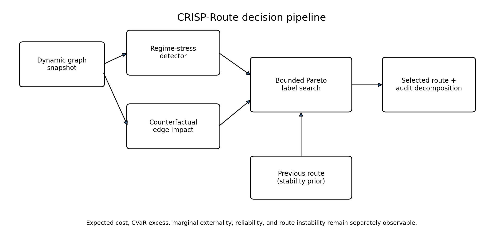
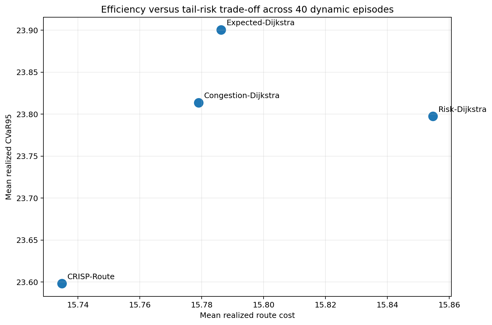

# CRISP-Route

**Counterfactual Regime-Informed Stochastic Pathfinding**

CRISP-Route is an experimental Python routing algorithm for dynamic graphs in which the cheapest expected path may not be the safest, most reliable, least congesting, or most operationally stable path. It combines a bounded Pareto label-setting search with four interpretable mechanisms:

- path-level tail-risk control using Gaussian CVaR excess;
- counterfactual marginal congestion externality;
- online regime-stress adaptation;
- a route-instability penalty that reduces unnecessary path switching.

The selected path is returned with a complete objective decomposition and a set of non-dominated alternatives. The implementation is domain-general, while the included benchmark uses a synthetic logistics/transportation network.

> **Research status:** version 0.1.0 is experimental research software. It is not a claim of proven academic novelty, a production navigation service, or a safety-certified routing system.

## Why CRISP-Route?

Classical shortest-path methods optimize a scalar edge weight. In dynamic systems, however, an edge can be inexpensive on average while having a dangerous upper tail, low reliability, high congestion impact, or a tendency to cause route thrashing when conditions fluctuate. CRISP-Route preserves those dimensions during search and scalarizes them only when selecting an operating route.

For a candidate path `P`, the default operating score is:

```text
score(P) = expected_cost(P)
         + risk_weight(regime) × CVaR_excess(P)
         + externality_weight(regime) × marginal_externality(P, demand)
         + reliability_weight(regime) × unreliability(P)
         + instability_weight × route_change(P, previous_path)
```

The search uses epsilon dominance and a configurable label cap to bound the otherwise potentially exponential multi-objective frontier.

## Installation

```bash
python -m pip install -e .
```

For development and benchmarks:

```bash
python -m pip install -e ".[dev,bench]"
```

## Quick start

```python
import networkx as nx

from crisp_route import CrispRouter, RouteContext, RouteWeights

G = nx.DiGraph()
G.add_edge(
    "warehouse",
    "fast_hub",
    mean_cost=4.0,
    std_cost=2.4,
    reliability=0.94,
    free_flow_cost=3.2,
    flow=95.0,
    capacity=100.0,
)
G.add_edge(
    "fast_hub",
    "customer",
    mean_cost=4.0,
    std_cost=2.2,
    reliability=0.95,
    free_flow_cost=3.2,
    flow=96.0,
    capacity=100.0,
)
G.add_edge(
    "warehouse",
    "safe_hub",
    mean_cost=5.2,
    std_cost=0.5,
    reliability=0.995,
    free_flow_cost=5.0,
    flow=42.0,
    capacity=120.0,
)
G.add_edge(
    "safe_hub",
    "customer",
    mean_cost=5.1,
    std_cost=0.4,
    reliability=0.996,
    free_flow_cost=4.9,
    flow=38.0,
    capacity=120.0,
)

router = CrispRouter()
result = router.route(
    G,
    "warehouse",
    "customer",
    RouteContext(
        demand=8.0,
        regime_score=1.4,
        weights=RouteWeights(
            risk=0.9,
            externality=0.5,
            reliability=1.2,
            instability=0.1,
        ),
    ),
)

print(result.path)
print(result.components.as_dict())
print(result.pareto_routes)
```

Run the complete example:

```bash
python examples/logistics_demo.py
```

## Edge attributes

CRISP-Route reads the following NetworkX edge attributes. Missing optional fields fall back to deterministic, uncongested behavior.

| Attribute | Meaning | Default |
|---|---|---:|
| `mean_cost` | Expected edge cost | `weight`, then `1.0` |
| `std_cost` | Standard deviation of edge cost | `0.0` |
| `reliability` | Probability of successful traversal | `1.0` |
| `free_flow_cost` | Uncongested edge cost for BPR impact | `mean_cost` |
| `flow` | Current edge flow | `0.0` |
| `capacity` | Edge capacity | infinity |
| `bpr_alpha` | BPR alpha parameter | `0.15` |
| `bpr_beta` | BPR beta parameter | `4.0` |

## Reproducing the benchmark

```bash
PYTHONPATH=src python benchmarks/run_benchmark.py --episodes 40 --draws 500
PYTHONPATH=src python benchmarks/create_assets.py
```

The committed benchmark seed produced the following aggregate results on an 8×8 directed grid with normal, congestion, disruption, and recovery regimes:

| Algorithm | Mean realized cost | Mean CVaR95 | Mean externality | Mean route churn | Median runtime |
|---|---:|---:|---:|---:|---:|
| CRISP-Route | 15.7349 | 23.5981 | 0.8382 | 0.0803 | 21.31 ms |
| Risk-Dijkstra | 15.8546 | 23.7973 | 1.3807 | 0.6286 | 0.22 ms |
| Congestion-Dijkstra | 15.7790 | 23.8137 | 0.8509 | 0.0676 | 0.24 ms |
| Expected-Dijkstra | 15.7863 | 23.9004 | 0.9905 | 0.1810 | 0.12 ms |

These numbers are synthetic and demonstrate behavior, not real-world superiority. CRISP-Route traded substantially more computation for a lower measured tail cost and a more balanced externality/stability profile.





## Repository structure

```text
src/crisp_route/          Core package
examples/                 Minimal usage example
benchmarks/               Dynamic graph generator and reproducible benchmark
tests/                    Unit tests
article/                  Medium-ready launch article
docs/                     Algorithm notes and generated figures
.github/workflows/        GitHub Actions test matrix
```

## Algorithmic limits

Multi-objective pathfinding can have an exponential Pareto frontier. CRISP-Route is therefore an approximate bounded-frontier method. With at most `K` labels per node, its practical search cost is approximately `O(K E log(K V))`, but this is not a worst-case optimality guarantee. Epsilon dominance, label caps, independence assumptions in the Gaussian path-risk model, and the lightweight regime detector all create approximation error.

The implementation currently targets `networkx.DiGraph`. Correlated path uncertainty, learned edge forecasts, time-dependent traversal, graph updates during a query, and formal approximation bounds are intentionally left for subsequent releases.

## Tests

```bash
PYTHONPATH=src pytest
```

The test suite covers CVaR behavior, congestion externality, risk-sensitive route selection, stability-aware routing, regime detection, and unreachable destinations.

## Citation

```bibtex
@software{curry_crisp_route_2026,
  author = {Curry, Brian},
  title = {CRISP-Route: Counterfactual Regime-Informed Stochastic Pathfinding},
  year = {2026},
  version = {0.1.0},
  url = {https://github.com/Bodhi8/crisp-route}
}
```

## License

MIT License. See [LICENSE](LICENSE).
